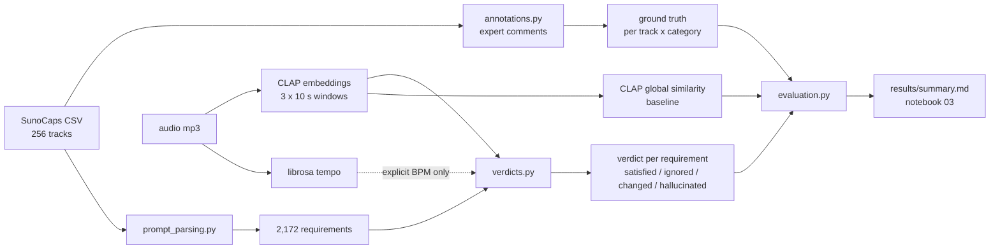

# Midterm status — AI Music Generation Validator

UCU AI course project · branch `modeling` · results notebook: [`notebooks/03_first_results.ipynb`](../notebooks/03_first_results.ipynb)
· all tables: [`results/summary.md`](../results/summary.md)

**Goal.** Check whether an AI-generated track follows its text prompt, requirement by requirement, in 6
categories (genre, instruments, vocals, tempo, mood, other), give each requirement a verdict
(`satisfied` / `ignored` / `changed` / `hallucinated`) and compare the verdicts with expert comments.
**Data.** SunoCaps: 256 Suno tracks = 64 MusicCaps prompts × 4 versions (`_1/_2` from the aspect list,
`_3/_4` from the caption); 183 tracks have an expert comment.

---

## 1. Technical

### Repository layout

```
src/aimv/
  data.py               load SunoCaps, derived columns, audio paths
  annotations.py        expert comments -> mismatch records -> ground truth (rules + manual reviews)
  vocab.py              term lists per category, spelling aliases, tempo words
  prompt_parsing.py     prompt -> requirements (rule-based, no LLM)
  audio/io.py, tempo.py, clap.py   audio loading, tempo estimation + checks, CLAP embeddings
  verdicts.py           requirement + cached CLAP evidence -> verdict
  evaluation.py         metrics, cluster bootstrap CIs, GroupKFold thresholds
scripts/   extract_audio_features.py -> build_ground_truth.py -> parse_prompts.py -> run_validation.py
           (+ check_audio_features.py, compare_tempo.py sanity checks)
notebooks/ 01 data exploration · 02 expert annotations · 03 first results
tests/     88 unit tests (pytest)
results/   metrics_*.csv, figures/, summary.md, listening sheets
data/      raw (SunoCaps CSV + mp3) and processed (cached features, labels) — not in git
```

### Pipeline



### How a requirement gets a verdict

| check | used for | rule |
|---|---|---|
| CLAP zero-shot, prior-corrected | tempo words ("slow", "fast", …) | top class of slow / medium / fast after dividing by the class means over all tracks |
| CLAP zero-shot | vocals present / absent, gender | p ≥ 0.5; wrong presence → `ignored`, wrong gender → `changed` |
| CLAP similarity, calibrated | everything else (genre, instruments, mood, other) | percentile of the track's similarity among tracks whose prompt does not mention the element; `satisfied` if ≥ tau (0.5), reversed for "no X" |
| CLAP zero-shot | vocals not mentioned in the prompt | vocals heard → `hallucinated` |
| librosa beat tracker | explicit BPM ("120 bpm") | ±8 %, half/double accepted (no such prompt in SunoCaps) |

### Baselines

- **Trivial:** predict a mismatch whenever the prompt has a requirement in that category.
- **CLAP global similarity:** cosine between the track and the whole prompt; low similarity = mismatch
  (track level only).

### Metrics

- Per (track, category) cell: precision / recall / F1 of the predicted mismatch, ROC-AUC of the mismatch
  score; micro and macro over the four categories with expert labels.
- Track level ("any mismatch"): ROC-AUC, and F1 at a threshold chosen with 5-fold GroupKFold over `original_id`.
- 95% CIs from a **cluster bootstrap over `original_id`** (1000 resamples): the 4 versions of a prompt share
  the prompt and often the comment, so they are not independent.
- Ground-truth subsets: **A** = commented tracks (main result), **A-reviewed** = A without cells that still
  need review, **B** = all 256 tracks with "no comment = OK".
- Separate checks: vocal presence (accuracy, macro-F1), emotion (8 classes, vs majority class), prompt
  parsing coverage vs expert records, aspect list vs caption (paired within `original_id`, Wilcoxon).

### Main results (subset A, 95% CIs)

| category | expert positives | F1 | ROC-AUC | trivial F1 |
|---|---|---|---|---|
| vocals | 70 | 0.75 [0.62, 0.85] | 0.84 [0.75, 0.91] | 0.55 |
| other | 74 | 0.64 [0.50, 0.75] | 0.76 [0.66, 0.85] | 0.70 |
| instruments | 38 | 0.36 [0.20, 0.51] | 0.55 [0.38, 0.71] | 0.35 |
| genre | 20 | 0.32 [0.06, 0.53] | 0.74 [0.59, 0.88] | 0.27 |
| micro | 202 | 0.58 [0.50, 0.65] | 0.76 [0.70, 0.82] | 0.48 |

Track level, all 256 tracks: ROC-AUC 0.64 [0.54, 0.74] (modular) vs 0.58 [0.46, 0.69] (CLAP global
similarity) vs 0.49 [0.39, 0.59] (trivial). Prompt parsing covers 96% of expert records by category and
92% by element (0 parser misses).

### Why these models

- **CLAP `laion/larger_clap_general`** — one model that scores any text-describable requirement zero-shot,
  so every category gets a check before specialised models exist. Sanity check: a track's own prompt has
  median rank 8–9 of 64 (random ≈ 32).
- **Not the music checkpoint:** the HF checkpoint `laion/larger_clap_music` produced near-identical embeddings
  in our setup (cosine 0.97–0.99 between different tracks, 0.999 between unrelated texts), tested with two
  transformers versions (4.46, 5.20); its normalisation layers are still at their initial values. The
  original music checkpoint via the `laion_clap` package is a later check.
- **CLAP instead of librosa for tempo words** (88 tracks with a tempo word, fast vs slow prompts):

  | estimator | median BPM / score, fast | slow | ROC-AUC |
  |---|---|---|---|
  | librosa beat tracker | 117 BPM | 126 BPM | 0.47 |
  | librosa, flat tempo prior | 126 BPM | 86 BPM | 0.69 |
  | CLAP zero-shot, p(fast) − p(slow) | 0.19 | −0.86 | 0.90 |

  The beat tracker is pulled towards ~120 BPM (no estimate below 78 BPM; slow songs come out at double tempo).
  CLAP leans towards "slow" (mean p 0.54), hence the prior correction (42 → 50 of 88 tempo words satisfied).
- **Why Essentia next:** 45% of the requirements (genre, instruments, mood) already map to Essentia classes
  (MTG-Jamendo instruments / moods, Discogs-400 genres). These are classifiers trained on labelled music, which
  should help exactly where CLAP is weakest (instruments, ROC-AUC 0.55). Essentia's TensorFlow models are
  easiest to run on Linux, hence Colab.

---

## 2. Progress

### Against the proposal

Items taken from the module plan (`src/aimv/__init__.py`) and the verdict vocabulary — please check them
against the proposal document.

| item | status | where / evidence |
|---|---|---|
| data loading and exploration | done | notebook 01 |
| expert comments → structured mismatch records → ground truth | done; 62 of 213 records still need review | notebook 02, `build_ground_truth.py` |
| prompt → requirements in 6 categories | done | `parse_prompts.py`; 92% element coverage |
| audio features: tempo, CLAP | done | `extract_audio_features.py` (~70 s for 256 tracks) |
| audio features: Essentia | not done | `essentia_*` requirements use CLAP for now |
| vocal presence / gender | partly: CLAP zero-shot only, no dedicated vocal model | `verdicts.py` |
| verdicts satisfied / ignored / changed / hallucinated | done; `partially_met` is never predicted | `verdicts.py` |
| evaluation vs experts with CIs and baselines | done | `run_validation.py`, `results/summary.md` |
| emotion | partly: zero-shot baseline (accuracy 0.32 vs 0.36 majority, macro-F1 0.23 vs 0.07) | notebook 03 |
| MuQ-MuLan, audio-LM judge, dashboard | not done | see plan |

### What didn't work, and why

1. **`laion/larger_clap_music`**: every input got almost the same embedding (see above), so all CLAP
   numbers use the general checkpoint.
2. **librosa tempo for tempo words**: octave errors make "fast" and "slow" prompts indistinguishable
   (ROC-AUC 0.47); a flat prior helps (0.69), CLAP works best (0.90).
3. **Instruments, ROC-AUC 0.55**: the weakest check. Probably many songs contain bass, drums or keys even
   when the prompt does not mention them (noisy calibration), and CLAP cannot confirm that one instrument
   is missing from a mix (notebook 03, example 3: "No strings" missed). Not verified yet.
4. **Only 13 of 183 commented tracks have no expert mismatch**: track-level results on commented tracks are
   very uncertain; we report all 256 tracks (no comment = OK) as the track-level comparison.
5. **No expert labels for tempo and mood** (0 of 213 records): these categories cannot be evaluated against
   the experts.
6. **The `Instrumental` column is a weak vocals label**: it is the generator setting, not a listening
   label (CLAP agrees on 82%, always "vocals" on 76%); 46 disagreements are in `results/vocals_listening.csv`.
7. **Error analysis findings** (notebook 03): the parser alias "stringed instrument" → strings is wrong for
   guitar prompts (one-line fix), and wordless vocables are not recognised as singing by the vocal text
   prompt (p = 0.01 on `-r7iz-9v9bA_3`).

### Who did what

| team member | contributions |
|---|---|
| _name 1_ | _…_ |
| _name 2_ | _…_ |

---

## 3. Plan until the final

Every experiment reuses the same verdict and evaluation code, cells and CIs, so results stay comparable;
model comparisons use a paired cluster bootstrap over `original_id` on the same cells.

| # | step | experiment design | success criterion | plan B |
|---|---|---|---|---|
| 1 | **Essentia instruments / genre / mood** (Colab) | run the MTG-Jamendo instrument and mood/theme models and the Discogs-400 genre model on the 256 tracks (same 10 s windows), cache activations; `essentia_*` requirements use the class activation with the same percentile calibration | instruments ROC-AUC clearly above CLAP's 0.55 (paired CI of the difference above 0); no category worse than CLAP | Essentia's Docker image locally; otherwise keep CLAP with better text templates (several phrasings averaged) |
| 2 | **MuQ-MuLan** | swap the joint audio–text model, keep everything else; compare per-category ROC-AUC and the track-level ROC with CLAP | better micro ROC-AUC, or better on a category CLAP handles badly | original LAION music checkpoint via `laion_clap` |
| 3 | **Own listening labels** | label `tempo_listening.csv` (24 tracks), `vocals_listening.csv` (46), and the mood words of ~40 tracks; both of us label an overlap of ≥ 20 tracks independently → Cohen's kappa; then accuracy of the tempo / vocal / mood verdicts | kappa ≥ 0.6, accuracy with CIs reported for tempo and mood | one annotator per sheet, reported as single-annotator labels |
| 4 | **Review the 62 pending records** | two reviewers read comment + prompt (and listen for the 8 audio-check records): accept / fix / reject; rebuild ground truth, rerun evaluation, report A vs A-reviewed | no record left in `needs_review` | report A-reviewed (pending cells dropped) as the main result |
| 5 | **Audio-LM judge on a subset** | an open audio–language model (e.g. Qwen2-Audio) in Colab answers yes/no per requirement for ~40 tracks stratified by category; compare with the experts and with our verdicts on the same cells; record time per track | agreement with experts at least that of our modular system on the subset | fewer tracks or only vocals + genre; otherwise describe as future work |
| 6 | **Dashboard** | Streamlit (or Gradio) app over `requirement_verdicts.csv`: audio player, prompt, requirement table with verdicts and scores, expert comment, filters by category / verdict | runs locally from the cached files | static HTML report generated from notebook 03 |
| 7 | **Final report** | follow the rubric; reuse `results/summary.md` tables, notebook figures and the error analysis | — | — |

Small fixes before the final: the "stringed instrument" alias, a text prompt that also covers wordless
vocals, and a rerun of `run_validation.py` afterwards.
