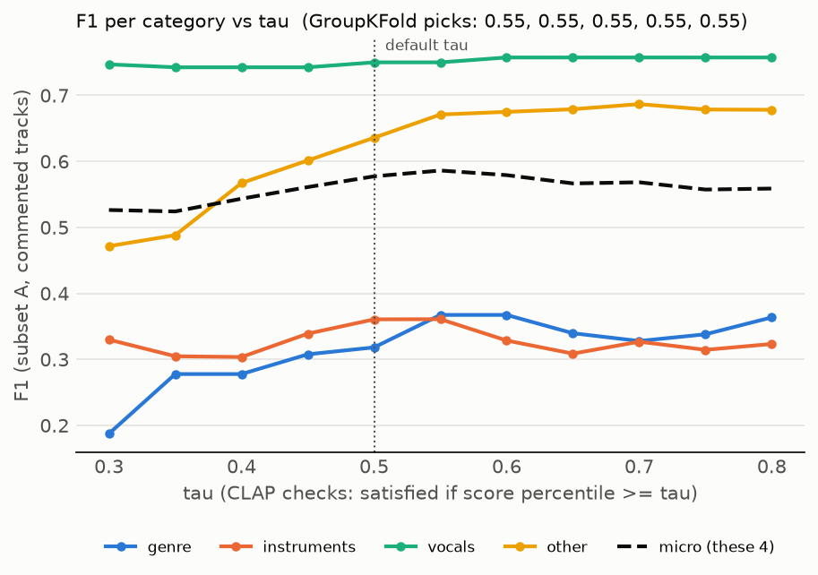
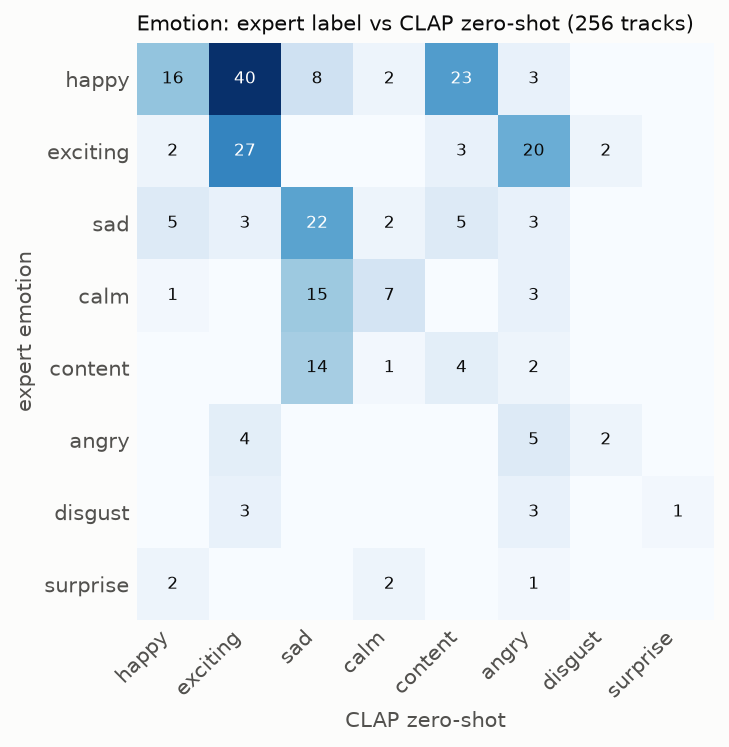
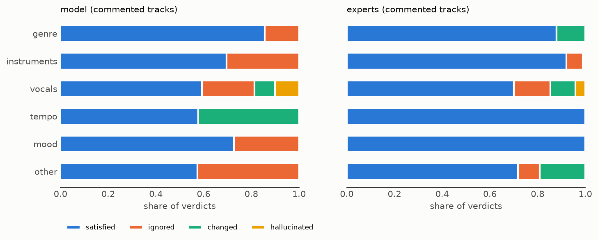

# Results summary

Model `laion/larger_clap_general` (cached embeddings), tau = 0.5, 95% CIs from a cluster bootstrap over original_id (1000 resamples). Subset A = commented tracks (main result), A-reviewed = A without cells that still need review, B = all 256 tracks with no comment = OK. Categories with fewer than 5 expert positives are marked *not enough labels*.

Scores for ROC-AUC (`pred_score` = max over the requirements of a category): 1 - score percentile for CLAP checks, the CLAP probability of the wrong answer for vocal presence / gender / hallucination, 0/1 for the rule-based tempo check. Essentia is postponed, so `essentia_*` requirements use CLAP.

## Verdicts

2240 rows: satisfied 1493, ignored 578, changed 65, hallucinated 34, not_checked 36, none 34, unknown 0 (none = no hallucinated vocals).

## 1. Per category, subset A (main result)

| category | positives | cells | precision | recall | F1 | ROC-AUC | trivial F1 | note |
|---|---|---|---|---|---|---|---|---|
| genre | 20 | 183 | 0.29 [0.05, 0.56] | 0.35 [0.08, 0.67] | 0.32 [0.06, 0.53] | 0.74 [0.59, 0.88] | 0.27 [0.08, 0.43] |  |
| instruments | 38 | 183 | 0.26 [0.13, 0.41] | 0.58 [0.35, 0.81] | 0.36 [0.20, 0.51] | 0.55 [0.38, 0.71] | 0.35 [0.19, 0.48] |  |
| vocals | 70 | 183 | 0.64 [0.48, 0.80] | 0.90 [0.80, 0.98] | 0.75 [0.62, 0.85] | 0.84 [0.75, 0.91] | 0.55 [0.40, 0.68] |  |
| tempo | 0 | 183 | 0.00 [0.00, 0.00] | – | 0.00 [0.00, 0.00] | – | 0.00 [0.00, 0.00] | not enough labels |
| mood | 0 | 183 | 0.00 [0.00, 0.00] | – | 0.00 [0.00, 0.00] | – | 0.00 [0.00, 0.00] | not enough labels |
| other | 74 | 183 | 0.62 [0.45, 0.77] | 0.65 [0.52, 0.79] | 0.64 [0.50, 0.75] | 0.76 [0.66, 0.85] | 0.70 [0.57, 0.81] |  |
| micro | 202 | 732 | 0.49 [0.42, 0.57] | 0.69 [0.60, 0.79] | 0.58 [0.50, 0.65] | 0.76 [0.70, 0.82] | 0.48 [0.44, 0.53] |  |
| macro | 202 | 732 | 0.45 [0.37, 0.54] | 0.62 [0.51, 0.74] | 0.52 [0.43, 0.60] | 0.72 [0.65, 0.80] | 0.47 [0.41, 0.52] |  |

Experts never flagged tempo or mood, so every model flag there counts as a false positive; those rows are not an evaluation of the tempo / mood checks.

## 2. Micro / macro across GT subsets

| subset | system | average | precision | recall | F1 | ROC-AUC |
|---|---|---|---|---|---|---|
| A_commented | modular | micro | 0.49 [0.42, 0.57] | 0.69 [0.60, 0.79] | 0.58 [0.50, 0.65] | 0.76 [0.70, 0.82] |
| A_commented | modular | macro | 0.45 [0.37, 0.54] | 0.62 [0.51, 0.74] | 0.52 [0.43, 0.60] | 0.72 [0.65, 0.80] |
| A_commented | trivial | micro | 0.33 [0.29, 0.37] | 0.90 [0.82, 0.96] | 0.48 [0.44, 0.53] | 0.63 [0.56, 0.70] |
| A_commented | trivial | macro | 0.34 [0.29, 0.38] | 0.90 [0.83, 0.96] | 0.47 [0.41, 0.52] | 0.62 [0.55, 0.69] |
| A_reviewed | modular | micro | 0.43 [0.35, 0.53] | 0.71 [0.60, 0.81] | 0.54 [0.45, 0.62] | 0.73 [0.66, 0.80] |
| A_reviewed | modular | macro | 0.44 [0.35, 0.54] | 0.70 [0.57, 0.81] | 0.53 [0.43, 0.61] | 0.73 [0.64, 0.82] |
| A_reviewed | trivial | micro | 0.32 [0.27, 0.38] | 0.95 [0.88, 0.99] | 0.48 [0.42, 0.55] | 0.61 [0.52, 0.69] |
| A_reviewed | trivial | macro | 0.35 [0.29, 0.41] | 0.95 [0.89, 0.99] | 0.49 [0.43, 0.55] | 0.63 [0.55, 0.71] |
| B_all | modular | micro | 0.39 [0.32, 0.46] | 0.69 [0.60, 0.78] | 0.50 [0.43, 0.56] | 0.76 [0.70, 0.81] |
| B_all | modular | macro | 0.38 [0.30, 0.45] | 0.62 [0.51, 0.74] | 0.46 [0.37, 0.52] | 0.72 [0.66, 0.79] |
| B_all | trivial | micro | 0.24 [0.19, 0.28] | 0.90 [0.82, 0.96] | 0.38 [0.31, 0.43] | 0.62 [0.55, 0.68] |
| B_all | trivial | macro | 0.24 [0.20, 0.29] | 0.90 [0.84, 0.96] | 0.37 [0.31, 0.43] | 0.61 [0.54, 0.67] |

Micro and macro use the categories with enough labels (genre, instruments, vocals, other).

## 3. Track level: any mismatch

| subset | system | positives | ROC-AUC | F1 | precision | recall |
|---|---|---|---|---|---|---|
| A_commented | modular system | 170/183 | 0.65 [0.50, 0.83] | 0.95 [0.91, 0.99] | 0.93 [0.85, 0.98] | 0.98 [0.95, 1.00] |
| A_commented | CLAP global similarity | 170/183 | 0.53 [0.25, 0.90] | 0.96 [0.92, 0.99] | 0.93 [0.85, 0.98] | 0.99 [0.97, 1.00] |
| A_commented | trivial (n categories with a requirement) | 170/183 | 0.51 [0.27, 0.78] | 0.96 [0.92, 0.99] | 0.93 [0.85, 0.98] | 1.00 [1.00, 1.00] |
| A_commented | modular (own rule: any category flagged) | 170/183 | 0.65 [0.50, 0.83] | 0.93 [0.89, 0.97] | 0.93 [0.87, 0.99] | 0.93 [0.88, 0.97] |
| B_all | modular system | 170/256 | 0.64 [0.54, 0.74] | 0.80 [0.73, 0.85] | 0.72 [0.62, 0.80] | 0.91 [0.85, 0.96] |
| B_all | CLAP global similarity | 170/256 | 0.58 [0.46, 0.69] | 0.80 [0.72, 0.86] | 0.67 [0.57, 0.76] | 0.98 [0.96, 1.00] |
| B_all | trivial (n categories with a requirement) | 170/256 | 0.49 [0.39, 0.59] | 0.79 [0.71, 0.86] | 0.66 [0.56, 0.76] | 0.99 [0.96, 1.00] |
| B_all | modular (own rule: any category flagged) | 170/256 | 0.64 [0.54, 0.74] | 0.80 [0.73, 0.86] | 0.71 [0.61, 0.80] | 0.93 [0.88, 0.97] |

F1 uses a threshold chosen on the other folds (5-fold GroupKFold over original_id). Subset A has very few negatives, so its ROC-AUC is noisy; B is the more informative track-level comparison.

## 4. tau for the CLAP checks

GroupKFold picks tau = 0.55, 0.55, 0.55, 0.55, 0.55 (one per fold). Out-of-fold F1 with the chosen tau vs the default:

| category | F1, tau = 0.5 | F1, tau by GroupKFold |
|---|---|---|
| genre | 0.32 [0.06, 0.53] | 0.37 [0.07, 0.60] |
| instruments | 0.36 [0.20, 0.51] | 0.36 [0.21, 0.50] |
| vocals | 0.75 [0.62, 0.85] | 0.75 [0.62, 0.85] |
| other | 0.64 [0.50, 0.75] | 0.67 [0.53, 0.78] |
| micro | 0.58 [0.50, 0.65] | 0.59 [0.51, 0.65] |
| macro | 0.52 [0.43, 0.60] | 0.54 [0.44, 0.61] |

## 5. Vocal presence (CLAP vs vocals_present_gt)

| label source | tracks | accuracy | macro-F1 |
|---|---|---|---|
| comment | 45 | 0.78 [0.64, 0.91] | 0.62 [0.42, 0.82] |
| instrumental_flag | 211 | 0.83 [0.75, 0.90] | 0.81 [0.72, 0.89] |
| all | 256 | 0.82 [0.75, 0.88] | 0.80 [0.70, 0.87] |

46 disagreements are in `results/vocals_listening.csv` for listening.

## 6. Tempo (listening check)

`results/tempo_listening.csv` is not labelled yet, so there is no tempo accuracy.

## 7. Emotion (8 SunoCaps emotions, zero-shot)

| method | accuracy | macro-F1 |
|---|---|---|
| CLAP zero-shot | 0.32 [0.23, 0.40] | 0.23 [0.16, 0.28] |
| CLAP zero-shot + prior correction | 0.29 [0.22, 0.36] | 0.22 [0.17, 0.27] |
| majority class (happy) | 0.36 [0.26, 0.45] | 0.07 [0.05, 0.08] |

## 8. Verdict shares per category (commented tracks)

| source | category | n | satisfied | ignored | changed | hallucinated |
|---|---|---|---|---|---|---|
| model | genre | 166 | 0.86 | 0.14 | 0.00 | 0.00 |
| model | instruments | 475 | 0.70 | 0.30 | 0.00 | 0.00 |
| model | vocals | 256 | 0.59 | 0.22 | 0.09 | 0.10 |
| model | tempo | 64 | 0.58 | 0.00 | 0.42 | 0.00 |
| model | mood | 286 | 0.73 | 0.27 | 0.00 | 0.00 |
| model | other | 294 | 0.57 | 0.43 | 0.00 | 0.00 |
| experts | genre | 166 | 0.88 | 0.00 | 0.12 | 0.00 |
| experts | instruments | 478 | 0.92 | 0.07 | 0.00 | 0.01 |
| experts | vocals | 240 | 0.70 | 0.15 | 0.10 | 0.04 |
| experts | tempo | 64 | 1.00 | 0.00 | 0.00 | 0.00 |
| experts | mood | 286 | 1.00 | 0.00 | 0.00 | 0.00 |
| experts | other | 294 | 0.72 | 0.09 | 0.19 | 0.00 |

Expert *satisfied* = parsed requirements minus expert ignored/changed records (approximation).

## 9. Aspect list vs caption (paired within original_id)

| measure | pairs | aspect list | caption | difference (aspect - caption) | Wilcoxon p |
|---|---|---|---|---|---|
| model: share of satisfied requirements (all categories) | 64 | 0.697 | 0.692 | 0.004 [-0.058, 0.067] | 0.803 |
| model: share of satisfied requirements (genre) | 33 | 0.871 | 0.879 | -0.008 [-0.152, 0.129] | 1.000 |
| model: share of satisfied requirements (instruments) | 59 | 0.712 | 0.698 | 0.014 [-0.091, 0.121] | 0.912 |
| model: share of satisfied requirements (vocals) | 44 | 0.690 | 0.656 | 0.034 [-0.064, 0.133] | 0.498 |
| model: share of satisfied requirements (tempo) | 13 | 0.654 | 0.577 | 0.077 [-0.192, 0.385] | 0.766 |
| model: share of satisfied requirements (mood) | 30 | 0.753 | 0.695 | 0.058 [-0.047, 0.168] | 0.365 |
| model: share of satisfied requirements (other) | 28 | 0.610 | 0.675 | -0.065 [-0.193, 0.071] | 0.351 |
| experts: share of tracks with a mismatch (no comment = OK) | 64 | 0.664 | 0.664 | 0.000 [-0.094, 0.086] | 0.914 |

Rates, not counts: aspect prompts have ~10.5 requirements, captions ~6.5.

## 10. CLAP vs Essentia vs their average

Essentia scores for 256 tracks (0 missing). 962 of 970 `essentia_*` requirements got an Essentia score (the rest keep CLAP: label not in the Essentia models or track missing); 256 tracks have an Essentia voice score. Same verdict rules, tau and calibration for every system; subset A (commented tracks).

| category | positives | F1 CLAP | F1 Essentia | F1 average | F1 trivial | AUC CLAP | AUC Essentia | AUC average |
|---|---|---|---|---|---|---|---|---|
| genre | 20 | 0.32 [0.06, 0.53] | 0.24 [0.00, 0.50] | 0.24 [0.00, 0.50] | 0.27 [0.08, 0.43] | 0.74 [0.59, 0.88] | 0.73 [0.53, 0.90] | 0.75 [0.59, 0.90] |
| instruments | 38 | 0.36 [0.20, 0.51] | 0.34 [0.18, 0.48] | 0.34 [0.17, 0.49] | 0.35 [0.19, 0.48] | 0.55 [0.38, 0.71] | 0.56 [0.41, 0.72] | 0.57 [0.40, 0.73] |
| vocals | 70 | 0.75 [0.62, 0.85] | 0.77 [0.65, 0.87] | 0.77 [0.65, 0.87] | 0.55 [0.40, 0.68] | 0.84 [0.75, 0.91] | 0.88 [0.80, 0.95] | 0.89 [0.82, 0.96] |
| other | 74 | 0.64 [0.50, 0.75] | 0.64 [0.50, 0.75] | 0.64 [0.50, 0.75] | 0.70 [0.57, 0.81] | 0.76 [0.66, 0.85] | 0.76 [0.66, 0.85] | 0.76 [0.66, 0.85] |
| micro | 202 | 0.58 [0.50, 0.65] | 0.58 [0.51, 0.65] | 0.58 [0.50, 0.66] | 0.48 [0.44, 0.53] | 0.76 [0.70, 0.82] | 0.77 [0.71, 0.83] | 0.78 [0.71, 0.84] |
| macro | 202 | 0.52 [0.43, 0.60] | 0.50 [0.40, 0.59] | 0.50 [0.40, 0.59] | 0.47 [0.41, 0.52] | 0.72 [0.65, 0.80] | 0.73 [0.66, 0.81] | 0.74 [0.67, 0.82] |

Track level (any mismatch):

| subset | system | ROC-AUC | F1 |
|---|---|---|---|
| A_commented | clap | 0.65 [0.50, 0.83] | 0.95 [0.91, 0.99] |
| B_all | clap | 0.64 [0.54, 0.74] | 0.80 [0.73, 0.85] |
| A_commented | essentia | 0.74 [0.57, 0.91] | 0.96 [0.91, 0.99] |
| B_all | essentia | 0.62 [0.53, 0.71] | 0.77 [0.69, 0.84] |
| A_commented | average | 0.71 [0.54, 0.91] | 0.95 [0.91, 0.98] |
| B_all | average | 0.65 [0.55, 0.74] | 0.80 [0.73, 0.86] |

Vocal presence vs `vocals_present_gt` (all 256 tracks):

| system | accuracy | macro-F1 |
|---|---|---|
| clap | 0.82 [0.75, 0.88] | 0.80 [0.70, 0.87] |
| essentia | 0.92 [0.87, 0.96] | 0.88 [0.81, 0.93] |
| average | 0.90 [0.85, 0.95] | 0.88 [0.80, 0.93] |

Paired difference **Essentia − CLAP** (same bootstrap resamples for both; a CI that excludes 0 means a real difference):

| level | subset | category | Δ F1 (or Δ accuracy) | Δ ROC-AUC |
|---|---|---|---|---|
| category | A_commented | genre | -0.07 [-0.19, 0.02] | -0.01 [-0.09, 0.07] |
| category | A_commented | instruments | -0.02 [-0.10, 0.05] | 0.01 [-0.11, 0.10] |
| category | A_commented | vocals | 0.02 [-0.06, 0.10] | 0.04 [-0.04, 0.13] |
| category | A_commented | other | 0.00 [0.00, 0.00] | 0.00 [0.00, 0.00] |
| category | A_commented | micro | 0.00 [-0.03, 0.04] | 0.01 [-0.02, 0.04] |
| track | A_commented | any mismatch | 0.00 [-0.01, 0.01] | 0.08 [-0.10, 0.20] |
| track | B_all | any mismatch | -0.03 [-0.08, 0.00] | -0.02 [-0.09, 0.05] |
| vocal presence | all | accuracy | 0.10 [0.01, 0.18] |  |
